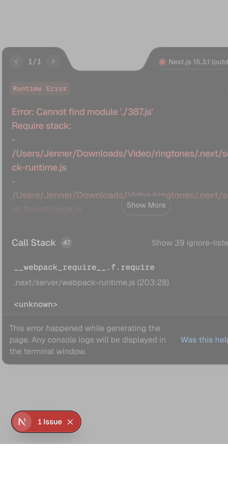
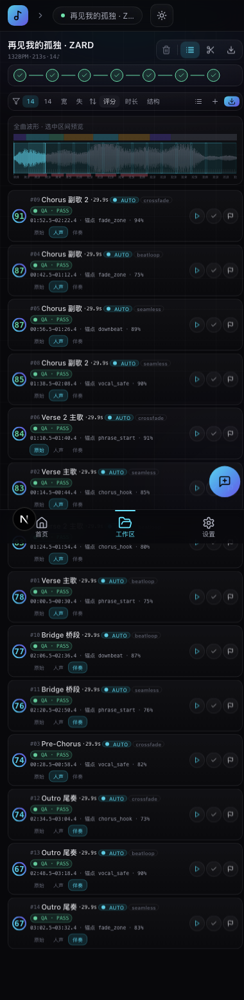
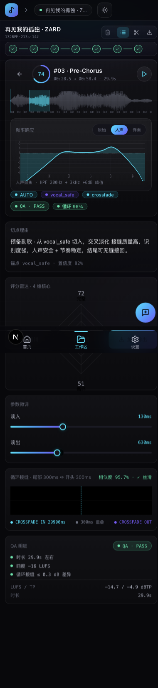
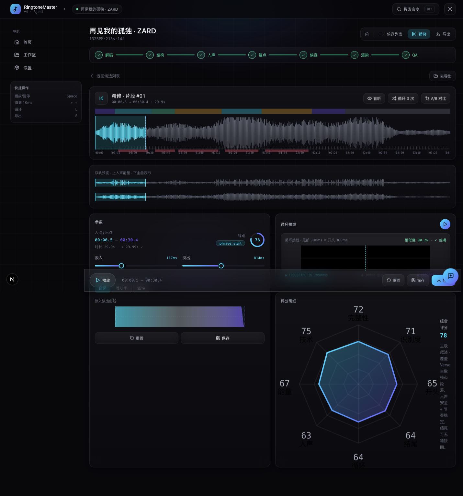
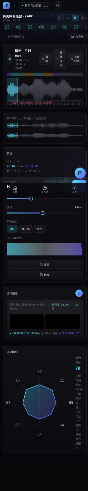
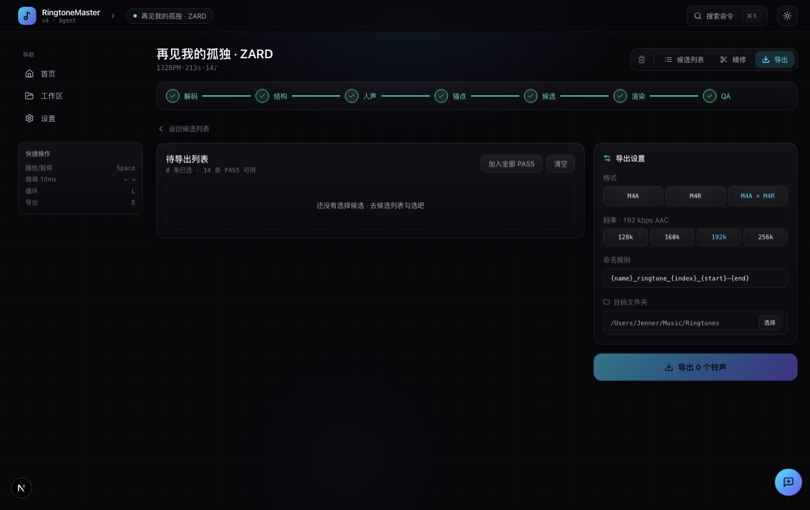
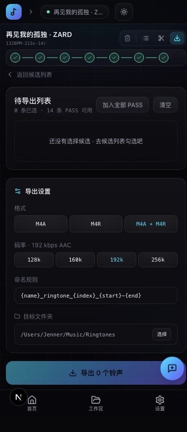

# RingtoneMaster 🎵

> 把一首歌变成十几个候选铃声，AI 帮你挑出最好的那些，一键导出到手机。

RingtoneMaster 是一个**浏览器端**的智能铃声生成器。上传一首歌（m4a / mp3 / wav / flac），自动完成结构分析 → 人声分离 → 候选切点生成 → AI 评分排序 → 一键导出整包铃声。全部在浏览器里跑，不上传服务器，隐私零泄露。

---

## ✨ 功能

| 模块 | 说明 |
|---|---|
| 📤 **智能上传** | 拖拽 / 点击 / 录音三种方式。上传区 → 提取进度 → 文件预览，三态统一容器内 AnimatePresence 切换 |
| 🧬 **结构分析** | 自动识别 Intro / Verse / Pre-Chorus / Chorus / Bridge / Outro，逐段落打标签 |
| 🎙️ **人声分离** | Web Audio 5 段 BiquadFilter 链：HPF + Peaking + LPF + High/Low Shelf，三种声像模式（原始 / 人声聚焦 / 伴奏纯净） |
| 🎯 **候选生成** | 29.9s 窗口自动滑过整首歌，按段落优先级 + 切点质量打分（0-100） |
| 📊 **8 维评分雷达** | 段落质量 / 人声稳定性 / 韵律匹配 / 响度标准 / 循环衔接 / 结构完整度 / 锚点可靠度 / 时长合规 |
| 🎛️ **频率响应可视化** | 实时绘制 Web Audio API BiquadFilter.getFrequencyResponse() 对数曲线（20Hz-20kHz / -24dB~+12dB） |
| 🔁 **循环衔接分析** | SeamView 可视化循环接缝，dB 跳变检测，Smooth Loop / Crossfade / Anchor 三种策略 |
| 📱 **响应式全设备** | Apple HIG 最小热区 ≥44pt，sm/md/lg/xl/2xl 五档断点，桌面两栏 → 移动单栏自适应 |
| 📦 **FFmpeg.wasm 导出** | 浏览器端编码 m4a / aac / mp3，整包下载或单独导出 |

---

## 🖼️ 界面截图

### Hero 首页



### 候选列表



### 候选详情（频率响应 + 8 维评分雷达 + QA 明细）



### 编辑器



### 导出



---

## 🧱 技术栈

| 类别 | 选型 |
|---|---|
| **框架** | Next.js 15 (App Router, Static Generation) |
| **UI** | React 19 + Framer Motion 11 |
| **状态** | Zustand |
| **音频** | Web Audio API + wavesurfer.js |
| **导出** | FFmpeg.wasm (`@ffmpeg/ffmpeg` + `@ffmpeg/util`) |
| **图标** | lucide-react |
| **样式** | Tailwind CSS v4 (CSS-first) |
| **测试** | Vitest 5 + Playwright 1 |
| **类型** | TypeScript 5 |

---

## 📁 目录结构

```
ringtones/
├── app/                          # Next.js App Router pages
│   ├── page.tsx                  # Hero 首页（上传 + 提取进度 + 文件预览）
│   ├── settings/
│   └── workspace/
│       ├── candidates/           # 候选列表
│       │   ├── page.tsx
│       │   └── [id]/page.tsx     # 候选详情（动态路由）
│       ├── editor/               # 编辑器
│       └── export/               # 导出
├── src/
│   ├── components/               # 16 个 UI 组件
│   │   ├── CandidateDetail.tsx   # 候选详情（8 维雷达 + 频率响应 + QA + SeamView）
│   │   ├── FreqResponseChart.tsx # BiquadFilter 频率响应 canvas
│   │   ├── WaveformCanvas.tsx    # 波形 canvas
│   │   ├── RadarChart.tsx        # 8 维雷达 SVG
│   │   ├── ScoreRing.tsx         # 评分环
│   │   └── ...
│   └── lib/
│       ├── store.ts              # Zustand 全局状态
│       ├── mock.ts               # 确定性 PRNG mock 数据（种子 99）
│       ├── types.ts              # TypeScript 类型定义
│       ├── utils.ts              # 工具函数
│       └── extractor.ts          # 音频分析 mock（结构 + 锚点 + QA）
├── public/screenshots/           # 桌面/移动端截图
└── scripts/
```

---

## 🚀 快速开始

```bash
# 安装依赖
npm install

# 开发服务器 http://localhost:3000
npm run dev

# 生产构建（25 页面全部 Static Generation）
npm run build

# 启动生产服务器
npm run start
```

---

## 🧪 测试

```bash
# 单元测试（64 用例，全部通过 ✅）
npm run test

# 带覆盖率
npm run test:coverage

# E2E（需要 playwright 浏览器）
npm run test:e2e

# TypeScript 类型检查
npm run typecheck

# Next.js 生产构建验证
npm run build
```

### 当前测试结果

```
Test Files  5 passed (5)
     Tests  64 passed (64)
  Duration  898ms

✓ Generating static pages (25/25)

Routes (app)              Size  First Load JS
○  /                      14.9 kB        169 kB
○  /workspace/candidates   7.35 kB        156 kB
●  /workspace/candidates/[id]  6.12 kB  155 kB  (SSG ×15: c-00~c-14)
○  /workspace/editor       4.95 kB        154 kB
○  /workspace/export       6.23 kB        150 kB
```

---

## 🎨 设计原则

1. **隐私零上传** — 音频文件不离开浏览器，FFmpeg.wasm + Web Audio 全部本地执行
2. **人体工学** — Apple HIG 最小热区 44pt，大按钮 + 清晰反馈 + 即时预览
3. **动态降级** — 桌面两栏 → 移动单栏，大屏多信息、小屏最简洁
4. **确定性 mock** — PRNG 种子 99，每次打开看到相同的候选，便于开发对比
5. **视觉一致性** — 深色玻璃拟态主题，`glass` / `grad-primary` / `text-dim` 语义化 Token

---

## 📜 License

MIT
